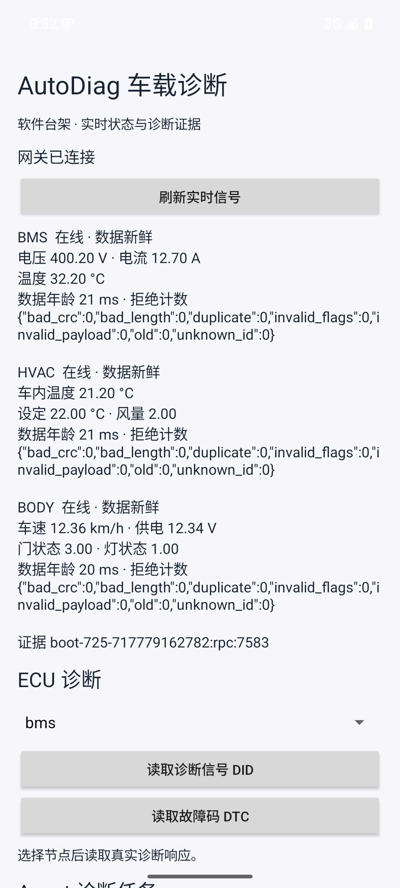

# AutoDiag-Agent

车载故障诊断与联调 Agent 项目。三个 C++ ECU 经虚拟 CAN 与原生 ISO-TP/UDS 提供实时信号及诊断服务，Python Agent 调用受限工具取证，Android 通过独立进程 AIDL 客户端查看信号、提交问题并呈现证据报告。包含九个台架场景、断点恢复和固定 60 项评测框架；模型成绩以实际评测报告为准。

远程仓库：<https://github.com/W-L-D-B/AutoDiag-Agent>

完整工程门禁已通过；首次冻结的 60 项真实模型评测完成并正确定位 55 项（91.7%），规则基线 60/60。5 项模型响应被严格校验拒绝；12 份定向抽查发现一处数值解释错误，引用有效不能代表全文事实正确。详见 [完整质检与评测报告](docs/完整项目质检与评测报告.md)。

## 开发环境

- Windows 11 + WSL2，独立发行版 `AutoDiagUbuntu`（Ubuntu 24.04）。
- C++17、GCC、CMake、Ninja、GDB；SocketCAN/vcan 与 Linux ISO-TP。
- Python 3.12 虚拟环境，MCP、HTTP 客户端、CAN/DBC/UDS 工具与开发检查依赖。
- Android 工具运行在 Windows，通过 TCP 与 Linux 服务通信。

[本机安装路径、验证结果和重启要求](docs/环境配置记录.md)

本机源码位于 `D:\Code\mi\AutoDiag_Agent`，WSL 内为 `/mnt/d/Code/mi/AutoDiag_Agent`，便捷入口为 `/home/autodiag/projects/AutoDiag_Agent`。它们是同一份源码。C++ 构建产物和 Python 环境位于 Linux 文件系统，避免重复 checkout 和混用 Windows/Linux 二进制。

## 日常启动

在仓库目录的 PowerShell 中运行：

```powershell
cd D:\Code\mi\AutoDiag_Agent
.\scripts\dev.ps1
```

进入 Linux 后：

```bash
source scripts/activate.sh
sudo /usr/local/sbin/autodiag-vcan up
cmake --preset linux-debug
cmake --build --preset linux-debug
ctest --preset linux-debug
python tools/check_environment.py
```

## 运行台架

在激活 Python 环境并完成构建后运行：

```bash
python scripts/run_bench.py --scenario baseline --output artifacts/demo-baseline
python scripts/run_bench.py --scenario corrupt_hvac_crc --output artifacts/demo-crc
python scripts/replay_log.py --dbc config/autodiag.dbc --log artifacts/demo-crc/frames.jsonl --output artifacts/demo-crc/replay.json
```

每次使用新的输出目录；非空目录不会被覆盖。一个接口同时只运行一个场景编排器。

| 场景 | 主要观察结果 |
|---|---|
| baseline | 三个节点 online，数据 fresh |
| drop_bms_data | BMS 心跳继续，但业务数据 stale |
| corrupt_hvac_crc | HVAC 坏 CRC 被拒绝，不刷新旧数据 |
| body_sequence_freeze | Body 重复序号被拒绝，数据最终 stale |
| bms_overtemperature | 125°C 是有效传输的数据，留给业务诊断判断 |
| lin_bad_checksum | HVAC 保留上次好温度，传感器有效位清零 |
| node_exit | Body 预期退出 42，心跳超时后 offline |
| old_bms_sequence | CRC 正确，但旧序号被拒绝，数据最终 stale |
| wrong_bms_scale | 总线电压缩小十倍，诊断 DID 仍返回内部模型电压 |

`manifest.json` 记录进程启动与退出，`frames.jsonl` 保存逐帧证据，`snapshot.json` 给出最终状态。独立回放器根据 DBC 与协议重新计算结果，并检查在线判定是否一致。

## 持续服务与诊断

在一个已激活 Python 环境的 WSL 终端运行：

```bash
python -m scripts.live_stack --scenario baseline
```

另一个 WSL 终端进入同一仓库并激活环境，读取持续更新的数据：

```bash
python -m scripts.rpc_client --method snapshot
python -m scripts.rpc_client --method read_did --params '{"node":"bms","did":53506}'
python -m scripts.rpc_client --method read_dtcs --params '{"node":"bms"}'
```

`53506 = 0xD102`，是 BMS 温度 DID。Ctrl+C 会停止该次启动的 ECU、服务和网关。TCP 仅监听 `127.0.0.1:18770`，不是公网接口。诊断发送后超时会隔离该 ECU 的诊断通道，重新运行整套台架恢复，详见接口契约。

## 启动诊断 Agent

将 `.env.example` 复制为未跟踪的 `.env`，本地填入模型凭据。WSL 环境中：

```bash
python -m scripts.live_stack --with-agent --scenario bms_overtemperature
```

在另一个已激活环境的 WSL 终端：

```bash
python -m scripts.ask_agent --question 'BMS温度是否异常？请读取DID和DTC后判断。' --output artifacts/my-task.json
```

也可在 Android 的“Agent 诊断任务”区域提交。模型 API 只由 Python 访问，API key 不进入 APK。八个受限工具使用同一注册表，同时提供 MCP stdio 入口。已通过真实 DeepSeek 推理、Android 完整提交和进程强杀后的检查点恢复；用法、限制和费用控制见 [Agent 运行说明](docs/agent-runtime.md)。

## 质量检查

```bash
bash scripts/quality.sh
```

门禁包括 Debug、ASan/UBSan、覆盖率构建与测试、C++ 格式和静态分析、Python 检查。覆盖率门槛为本项目 `src/`、`apps/`、`include/` 源代码行的 80%；结果保存在本地 `artifacts/qa/`。GitHub Actions 使用相同入口。

Windows 中可运行 `.\scripts\android.ps1 Doctor` 检查模拟器加速，使用 `.\scripts\android.ps1 Start` 启动 `AutoDiag_API35`。启动 IDE 使用 `.\scripts\android.ps1 Studio`。WHPX 功能已启用，且已通过实际 Android 15 冷启动验证。

在 Windows 仓库根目录运行 `python android/build.py` 构建调试 APK，输出 `artifacts/android/AutoDiag-Agent-debug.apk`。用 `D:\Android\Sdk\platform-tools\adb.exe install -r artifacts/android/AutoDiag-Agent-debug.apk` 安装后打开 AutoDiag，保持上述 WSL 持续台架运行即可读取信号、DID 和 DTC。已实际验证跨进程 Binder、网关死亡后重绑以及后端断连提示，详见 [Android 客户端说明](docs/android-client.md)。

`vcan0` 由 `autodiag-vcan.service` 随发行版启动自动创建；上面的手动启用命令也可用于恢复。环境检查会实际验证 TCP、Unix Domain Socket、虚拟 CAN 收发、48 字节 ISO-TP 传输和 GitHub 读取，报告写入被忽略的 `artifacts/environment-check.json`。它只发送虚拟总线流量。

## 环境复现

Windows 中以 root 调用系统依赖初始化（不会修改 `CodexUbuntu`）：

```powershell
wsl -d AutoDiagUbuntu -u root -- bash /mnt/d/Code/mi/AutoDiag_Agent/scripts/bootstrap-ubuntu.sh
wsl --manage AutoDiagUbuntu --set-default-user autodiag
```

普通用户安装 Python 环境：

```bash
bash scripts/setup-python.sh
```

常规 Linux 管理操作可以通过 `wsl -d AutoDiagUbuntu -u root` 执行。新建用户不设置公共默认密码；若需要在 Linux 内使用常规 sudo，可在 root 会话运行 `passwd autodiag` 设置自己的密码。无密码 sudo 仅开放项目的固定 vcan 启停命令。

## 仓库与凭据

`origin` 使用 SSH。专用 Linux 用户通过 Windows OpenSSH 访问现有密钥，不向仓库或 WSL 复制私钥。`.env`、`.codex`、临时 PDF 预览、构建目录和运行日志均已忽略。

模型 API 信息填写到未跟踪的 `.env`。不要把密钥提交到 Git。开发接口只绑定本机回环地址，当前系统用于纯软件虚拟台架。

## 设计资料

[AutoDiag 项目设计](docs/项目设计.md)

- [前两周计划与验收标准](docs/week1-2-plan.md)
- [协议 v1：报文、时间与证据格式](docs/protocol-v1.md)
- [从定义开始的实现讲解](docs/前两周实现与原理.md)
- [前两周质检结果与复现方法](docs/前两周质检报告.md)
- [完整交付计划与验收矩阵](docs/completion-plan.md)
- [UDS 诊断字节契约](docs/diagnostics-v1.md)
- [持续服务 RPC 契约](docs/service-api-v1.md)
- [第二阶段：从 CAN 广播到诊断服务](docs/第二阶段实现与原理.md)
- [第二阶段质检报告](docs/第二阶段质检报告.md)
- [Android 构建、AIDL 与模拟器验收](docs/android-client.md)
- [Agent 循环、MCP、任务状态与预算](docs/agent-runtime.md)
- [60 项评测构成与评分方法](evaluation/README.md)
- [从定义开始的完整项目教学与演示](docs/完整项目教学与演示.md)
- [完整质检、60 项真实模型结果与已知边界](docs/完整项目质检与评测报告.md)



个人简历分析调研稿仅保留在本地，不同步至公开仓库。
