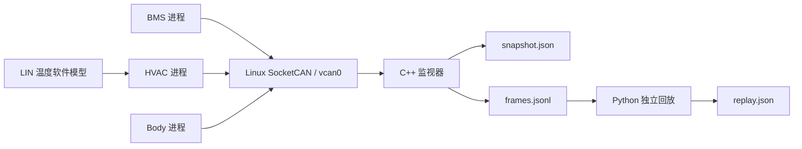

# 前两周实现与原理：从 ECU 到可复现的故障证据

前两周的目标是搭建后续诊断 Agent 要调用的车端实验环境。它包含三个独立 C++ ECU 进程、一个 C++ 监视器、虚拟 CAN、HVAC 内部的 LIN 温度模型，以及场景编排和离线回放工具。模型推理、业务 UDS 服务和 Android 应用按后续里程碑开发。

## 1. 先认识项目里的对象

| 名称 | 定义 | 在项目中的对应物 |
|---|---|---|
| ECU | Electronic Control Unit，负责某类车辆功能的电子控制单元 | 一个独立运行的 C++ 进程 |
| BMS | Battery Management System，电池管理系统 | 发布电压、电流和温度的虚拟节点 |
| HVAC | Heating, Ventilation and Air Conditioning，空调与通风系统 | 发布车内温度、目标温度、风量和传感器有效性 |
| Body | 车身功能控制 | 发布车速、门状态、灯状态和低压供电 |
| 信号 | 一个具有含义、单位和有效范围的数值 | 例如 `temperature_c=32.0`，单位摄氏度 |
| CAN 帧 | 总线上一次传递的消息，含 CAN ID 与数据字节 | 例如 ID `0x180`、数据 `A00F7D004001009A` |
| DBC | 对 CAN 帧里的位、字节、缩放和单位作约定的描述文件 | `config/autodiag.dbc` |
| 心跳 | 节点周期发送的存活信息 | `0x700`、`0x701`、`0x702` 三类帧 |
| 新鲜度 | 距离最后一次接受有效数据经过了多久 | 数据达到 500 ms 未更新即 stale |
| Agent | 能根据目标选择步骤、调用工具并利用结果调整行动的程序 | 后续读取这些信号、日志和验证结果的诊断层 |

真实 ECU 有 MCU、传感器、供电和 CAN 收发器。本台架用进程与确定性模型模拟其软件行为，用 Linux 虚拟总线代替物理连线，因此普通电脑即可运行。

## 2. 三个 ECU 为什么要分成三个进程

每个进程有自己的内存、生命周期和发送节奏。一个节点退出时，其他节点仍然能运行，监视器可以观察到“某个节点掉线”。这为以后练习服务退出、通信中断和恢复提供了明确边界。

`autodiag-ecu` 是同一个可执行文件，`--node` 决定当前进程扮演哪一种 ECU。运行台架时，编排器分别启动它三次；此外还启动一个 `autodiag-monitor`，所以业务台架共四个 C++ 进程。



Linux 的 SocketCAN 把 CAN 接口暴露为 socket。进程通过内核发送、接收真实的 CAN 帧结构；`vcan0` 是无需控制器硬件的虚拟 CAN 设备。这个流程能验证进程间总线通信，不能验证收发器电气、物理仲裁、实际总线带宽或硬实时表现。

## 3. 从一个温度数值到八个字节

CAN 接收者必须事先知道每个字节的含义。协议 v1 对 BMS 状态作了以下约定：

| 字节 | 含义 | 原始整数到物理值 |
|---|---|---|
| 0..1 | 电池电压，无符号小端整数 | raw × 0.1 V |
| 2..3 | 电流，有符号小端整数 | raw × 0.1 A |
| 4..5 | 温度，有符号小端整数 | raw × 0.1 °C |
| 6 | 8 位递增计数器 | 0..255，之后回到 0 |
| 7 | 应用层 CRC8 | 对 CAN ID 与前七个数据字节计算 |

以协议测试中的已知向量为例：

```text
CAN ID: 0x180
数据:   A0 0F | 7D 00 | 40 01 | 00 | 9A
原始值: 4000  | 125   | 320   | 0  | CRC8
物理值: 400 V | 12.5 A| 32 °C
```

“小端”表示低位字节在前，所以 `A0 0F` 对应整数 `0x0FA0=4000`。使用有符号整数后，负电流和负温度也能表达。

DBC 保存这些约定，C++ 按约定编码，Python `cantools` 再独立解码。两套实现处理同一组已知字节，可以发现端序、正负号、比例系数和位偏移错误。DBC 的数值范围也不自动等于 CRC 校验或完整业务校验，接收代码仍需执行它们。

## 4. 节点在线与数据新鲜为什么要分开

一个节点有两类消息：

- 状态数据目标周期 100 ms，回答“它现在提供什么测量值”。
- 心跳目标周期 250 ms，回答“它是否还在运行”。

监视器只用有效心跳判断 online，只用有效状态帧判断数据 freshness。因此可能同时出现 `online=true` 和 `data_status=stale`：节点进程还活着，但业务数据已经停止更新。

这正是 `drop_bms_data` 场景。BMS 停止发状态数据，仍继续发心跳。监视器会保留最后的好值，但将数据状态标为 stale，提醒上层不能把旧值当作当前测量。

协议用单调时钟计算年龄。系统校时或修改日期不会改变这些超时判断。500 ms 和 1200 ms 是本实验协议的阈值，不代表真实车型的要求。

## 5. 接收到一帧，不代表接受了这一帧

监视器依次检查帧类型、ID、长度、CRC、字段约束和序号。只有被接受的帧才更新缓存与时间。被拒绝的帧仍写入原始证据日志，并累计明确的拒绝原因。

例如，空调节点持续发送损坏 CRC 的状态帧时，内核仍会把这些字节交给监视器，但它们不会刷新温度；因此接收计数可以增长，数据仍然 stale。

项目的 CRC8 是应用层校验，参数和覆盖的字节范围写在协议文档中。它与真实 CAN 控制器在链路层处理的 CRC 是两个不同层次。

## 6. 序号、回绕与节点重启

8 位计数器只能表示 0..255。接收端用模 256 的差值判断更新方向：

```text
last=255, new=0  -> 差值1，接受，属于正常回绕
last=10,  new=10 -> 差值0，重复，拒绝
last=10,  new=9  -> 差值255，旧序号，拒绝
```

重复帧不能为自己“续命”。即使数据已经过期，同一个计数器仍然是重复；否则冻结序号故障会在每次过期后被错误恢复成 fresh。

节点重启是另一件事。有效心跳显示 uptime 回退，或心跳离线后重新出现，才会开始一个新的节点 epoch。接收端会清空上一轮启动的数据，等待新状态帧建立基线。

v1 使用 8 位半窗口比较，长时间数据缺口可能造成方向歧义。这个限制已经明确记录；未来扩展可采用更宽的序号或显式会话编号。

## 7. LIN 模型在这里起什么作用

HVAC 内部有一个简化的 LIN 温度传感器模型。它生成保护 ID、温度字节和增强校验和，HVAC 校验成功后才更新 last-good 温度。

已知向量为：PID `0x92`，温度字节 `D2 00`（21.0 °C），增强校验和 `0x9A`。`lin_bad_checksum` 场景破坏这一校验和，HVAC 保留上次好温度，清除 `cabin_sensor_valid`，并在心跳中表达输入降级。

此时外层 CAN CRC 仍然正确。这个场景让上层区分“CAN 传输数据有效”和“CAN 所携带的传感器读数无效”。模型处理的是协议字段与校验逻辑，没有模拟 LIN 收发器或波形。

## 8. 七个场景怎样帮助练习排障

| 场景 | 注入方式 | 应观察到的证据 |
|---|---|---|
| baseline | 不注入故障 | 三节点 online，数据 fresh |
| drop_bms_data | BMS 状态停止 | BMS 心跳在线，状态 stale |
| corrupt_hvac_crc | 空调状态 CRC 错误 | bad_crc 增加，坏帧不更新信号 |
| body_sequence_freeze | 车身状态序号冻结 | duplicate 增加，随后数据 stale |
| bms_overtemperature | BMS 发布 125 °C | 传输有效，数值显示过温 |
| lin_bad_checksum | LIN 校验失败 | CAN 帧有效，空调传感器有效位清零 |
| node_exit | Body 进程退出 | 预期退出码 42，心跳最终 offline |

这些场景由固定配置、seed 和故障参数控制。相同 seed 与逻辑 tick 的模型输入应产生相同数值；真实运行的时间戳、心跳 uptime 和边界帧数量会受系统调度影响。对同一份已捕获日志作回放，则应得到完全一致的最终判定。

## 9. 为什么要保留三种证据

- `manifest.json` 记录如何启动台架、seed、进程参数和退出码，属于测试编排信息。
- `frames.jsonl` 保存逐帧原始字节及在线接收判定，包含开始和结束时刻。
- `snapshot.json` 保存结束时每个节点的在线、新鲜度、信号与拒绝计数。

离线回放器只读取日志和公开 DBC，重新计算 CRC、序号与状态；它不读取场景名称或注入真值，也不直接相信日志里的 `accepted` 字段。若记录声称“接受”，独立计算却认为 CRC 错误，回放应指出证据不一致。

以后诊断 Agent 应通过受约束工具获得信号和证据。测试用故障真值不能直接交给它当答案。

## 10. 怎样运行与继续学习

Windows PowerShell：

```powershell
cd D:\Code\mi\AutoDiag_Agent
.\scripts\dev.ps1
```

进入 Linux：

```bash
source scripts/activate.sh
cmake --preset linux-debug
cmake --build --preset linux-debug --parallel 2
python scripts/run_bench.py --scenario baseline --output artifacts/demo-baseline
python scripts/replay_log.py --dbc config/autodiag.dbc --log artifacts/demo-baseline/frames.jsonl --output artifacts/demo-baseline/replay.json
```

输出目录已存在且非空时，选择一个新目录，保留原有证据。故障演示只需把 scenario 换成表中的名称。

建议阅读顺序为：`config/autodiag.dbc` → `include/autodiag/protocol.hpp` 与 `src/protocol.cpp` → `src/lin.cpp` → `src/state.cpp` → `src/socketcan.cpp` → `apps/` → Python 编排和回放 → 测试与质检报告。

## 11. 质检分别能证明什么

- 单元测试：用明确输入和假时间验证字节、校验、序号与状态转换。
- 契约测试：使用独立 DBC 工具校对 C++ 的字节解释，并检查日志回放约束。
- 集成测试：运行真实进程，通过真实内核 `vcan` 收发并检查每个场景。
- ASan/UBSan：在测试执行路径上寻找内存问题和未定义行为。
- 覆盖率：说明哪些源代码在测试中执行过；比例高仍不等于没有缺陷。
- 独立代码审查：检查测试之外的设计、失败清理、输入验证和证据边界。

实际通过数量、覆盖率和执行结果以同目录的质检报告为准。
