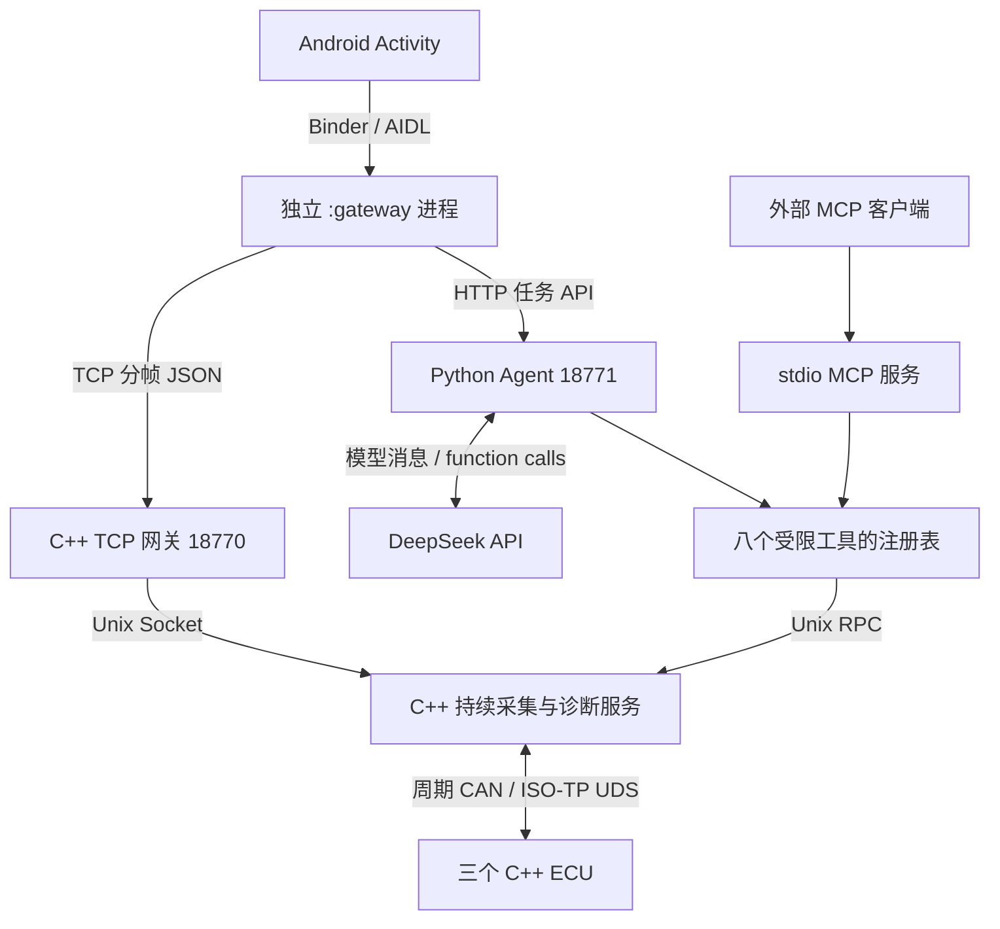

# AutoDiag-Agent：从定义到完整闭环

## 一、这个项目解决什么问题

车载软件联调时，“收不到新温度”可能来自很多地方：ECU 退出、数据发布停止、CRC 错误、重复计数器、旧帧、传感器输入失效，或者只是客户端拿到了旧快照。它们不能统一解释为“温度为零”或“整车故障”。

AutoDiag 的目标是让工程师用自然语言提出问题，系统主动读取可核验的通信与诊断证据，区分这些情况并生成报告。底层采用确定性的 C++ 协议与状态机；模型选择调查步骤、组织解释。全部 ECU 和总线都是本机软件台架。

## 二、先认清几个名词

| 名词 | 在本项目中的含义 |
|---|---|
| ECU | 独立 C++ 进程，模拟 BMS、HVAC、Body 控制器 |
| CAN / SocketCAN / vcan | CAN 是报文通信机制，SocketCAN 是 Linux 套接字接口，vcan 是没有电气层的虚拟接口 |
| DBC | 定义 CAN ID、信号位置、大小端和物理量缩放的描述文件 |
| CRC / Counter | 检查应用报文内容与序号；并不替代总线电气诊断 |
| LIN | HVAC 内部温度输入的协议模型，验证 PID 与 checksum；没有连接物理 LIN 收发器 |
| ISO-TP | 将较长诊断报文拆成 CAN 帧并重组，项目调用原生 CAN_ISOTP |
| UDS / SID / DID / DTC | 诊断协议、服务编号、数据编号、故障码；项目实现只读为主的有限子集 |
| IPC | 进程间通信；Linux 使用 Unix Socket，Android 使用 Binder/AIDL |
| Agent / Tool | 有界的模型与工具循环；工具负责实际读取与固定检查 |
| MCP | 标准化工具访问协议；项目用同一注册表提供 stdio MCP 服务 |
| Checkpoint | 用 SQLite 保存任务、工具步骤与累计预算，支持中断后恢复 |

## 三、一张图理解全链路



Android 的第一条链路直接看实时数据；第二条链路提交一个诊断任务。内置 Agent 直接调用工具注册表；外部 MCP 客户端通过协议访问同一份工具实现。不能声称每一次内置模型取证都经过 MCP 网络传输。

## 四、先理解车端，再理解模型

周期 CAN 数据像“不断报数”。服务收到合法报文才更新数据时间。数据超过 500 ms 未更新就 stale；心跳超过 1200 ms 未更新才 offline。因此 online=true 和 data_status=stale 完全可以同时出现。

计数器按八位环绕比较：差值 0 是重复，1..127 是前进，128..255 是旧帧。没有收到新业务数据不能自动清除序号状态，否则旧帧可冒充新帧。只有心跳给出重启/恢复证据才重同步。

UDS 是“主动问答”。读取 BMS 温度先进入扩展会话 `10 03`，再发送 `22 D1 02`。例如回复 `62 D1 02 E2 04`：DID 为 D102，数据小端 `0x04E2=1250`，乘 0.1 是 125°C。NRC 否定响应与完全没回复是不同结果。

同一 ECU 的诊断事务串行；发送后超时会隔离诊断通道。原因是 UDS 没有应用请求编号，迟到旧响应可能与下一次同 DID 响应完全相同。要求整栈重启恢复是明确的错误处理策略，不能悄悄给旧响应分配新证据编号。

## 五、Agent 如何诊断一次过温

1. 用户提出“BMS 温度为什么异常”。HTTP 返回 task_id，界面轮询任务状态。
2. Agent 获取实际服务快照，模型看到 BMS 心跳在线、数据新鲜、温度 125°C、拒绝计数为零。
3. 模型选择读取 D102、DTC，可能再看温度窗口。工具通过 C++ 与真实虚拟总线取得响应。
4. 若 DID 同样为 125°C，且 A10001 表示上报温度超过 90°C，就支持“模型当前上报过温”。通信新鲜不能证明温度正常。
5. 模型给出结构化报告，运行时检查格式、引用是否来自本次尝试，以及车辆状态假设是否包含成功实时证据。

工具返回失败时，错误收据只证明读取失败，不能证明车辆健康。模型仍可能在自然语言中出现不够准确的解释；引用存在检查不能替代全部语义审查，所以还要做独立评测与人工抽查。

## 六、为什么不是直接让大模型读日志

日志可能包含旧数据，也可能包含注入器的正确答案。项目让评测器持有 scenario 与 expected_codes，Agent 只接触问题、公开接口片段和实际工具结果。`query_contract` 使用关键词检索三份公开契约，没有向量数据库，也不能读取任意文件。

工具参数使用严格结构化校验，不能运行 shell、改 ECU 程序、发送任意 CAN 帧或访问模型指定 URL。`run_probe` 和 `run_regression` 执行固定读取序列，不是让模型生成并执行代码。

## 七、断点恢复到底恢复什么

SQLite 保存任务和累计调用次数。进程被强杀后，重启会把未完成任务改成 interrupted；显式恢复保留 task_id 和预算，但重新获取快照、重建模型上下文。旧步骤可以供人追溯，旧证据不能被恢复后的最终报告直接引用。

实际验收已在模型请求期间 SIGKILL Agent，再重启并恢复，累计 3 次模型调用完成。Android 也实际提交过真实 API 任务，并显示取证步骤和最终报告。工程离线测试不消耗模型 API，真实评测单独记账。

## 八、自己演示一遍

在 PowerShell 进入 `D:\Code\mi\AutoDiag_Agent`，运行 `scripts/dev.ps1` 进入专用 WSL；随后：

```bash
source scripts/activate.sh
cmake --preset linux-debug
cmake --build --preset linux-debug
python -m scripts.live_stack --with-agent --scenario bms_overtemperature
```

另一个激活环境的 WSL 终端：

```bash
python -m scripts.rpc_client --method snapshot
python -m scripts.rpc_client --method read_did --params '{"node":"bms","did":53506}'
python -m scripts.ask_agent --question 'BMS温度是否异常？请读取DID和DTC后判断。' --output artifacts/my-first-report.json
```

已有 API 配置只保存在本机 `.env`。每次输出使用新文件。模型服务需账号可用；API 的实际调用可能产生费用。Ctrl+C 停止此次台架创建的进程。

接着做三个对照：停止台架，以 `drop_bms_data` 重启，观察在线但数据旧；再以 `wrong_bms_scale` 比较约 40V 广播与约 400V DID；最后以 `node_exit` 观察 Body 心跳真正离线。不要同时启动多套 vcan0 台架。

Android 可通过 `python android/build.py` 构建并用 adb 安装调试 APK。运行台架后先刷新信号，再读取 DID/DTC，最后提交同一问题，理解 Activity、AIDL 服务、HTTP Agent 与 Linux 服务各负责哪一步。

## 九、怎样对应汽车 C++ 实习岗位

| 岗位要求 | 项目中的具体证据 |
|---|---|
| Linux/Android 应用开发 | C++ ECU/持续服务/网关，Android Activity 与独立 AIDL 服务 |
| IPC、TCP/IP、socket | Unix Socket、分帧 TCP、SocketCAN、Binder；半包/粘包/超时测试 |
| CAN/LIN/Ethernet | CAN/vcan 与 LIN 协议模型、TCP socket；不冒充物理总线或车载 Ethernet 协议栈认证 |
| Python/C/C++ | C++17 原生协议与并发服务，Python 编排/Agent/评测，Java Android 客户端 |
| 联调与问题排查 | CRC、旧序号、数据 stale、UDS NRC、缩放不一致、断连恢复与进程回收 |
| 跨团队接口与文档 | 协议与 RPC 契约、类型校验、兼容边界、实现和验收文档 |
| 软件流程与质量 | Git 分阶段提交、回归用例、ASan/UBSan、覆盖率、静态分析和 GitHub CI |

AUTOSAR 需要另外学习分层、RTE、COM/PduR/CanIf/CanDrv、DCM/DEM 与 Adaptive 服务通信概念。当前代码没有 AUTOSAR BSW 或 RTE，简历应写“熟悉相关分层思想/诊断概念”，不要写已实现完整 AUTOSAR。

面试讲项目时，按一个可复现故障深入：为什么心跳在线不等于数据新鲜，怎样通过 DID 交叉取证，怎样防止迟到回复污染证据，怎样证明跨进程与恢复确实发生。准确率、调用数和覆盖率引用最终实测报告，并能打开代码与原始本地记录解释。
