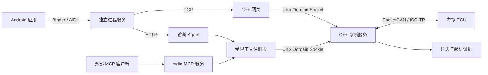

# AutoDiag-Agent 项目设计

AutoDiag-Agent 是面向车载应用开发的故障诊断与联调实验平台。目标是在普通电脑上构建可运行的虚拟 ECU、C++ 服务、Android 客户端和诊断 Agent，通过工具调用获取证据并验证故障假设。

## 当前状态

已实现 C++ 多进程虚拟 ECU、CAN/DBC、HVAC LIN 协议模型、原生 ISO-TP/UDS、持续采集服务、Unix/TCP 网关、Android 独立进程 AIDL 客户端、真实 DeepSeek Agent、MCP 工具入口、SQLite 中断恢复和固定 60 项评测器。工程验收、模型成绩和已知边界见完整质检报告；前两周文档作为 M1 历史记录保留。

## 已实现的模块

| 模块 | 责任 |
|---|---|
| C++ 虚拟 ECU | BMS、空调、车身状态、心跳与故障注入 |
| C++ 网关与诊断服务 | CAN 信号解码、数据新鲜度、ISO-TP/UDS 子集、Unix Domain Socket 和 TCP |
| Android 客户端 | 独立进程 AIDL/Binder 服务、信号展示、诊断任务与证据报告 |
| Python Agent 与 MCP 工具 | 选择诊断步骤、读取结构化数据、调用验证探针、组织结论 |
| 独立评测器 | 保管故障真值，评价根因定位、证据有效性、调用次数和耗时 |

## 实现边界

- CAN 使用 Linux SocketCAN/vcan，LIN 采用协议与调度的软件模型，不代表电气或实车验证。
- Android 首先实现应用级 AIDL/Binder；系统 VHAL 集成属于不同的开发范围。
- AUTOSAR CP/AP 相关学习和接口映射不能表述为完整标准平台实现。
- 模型负责诊断步骤与假设选择；协议解析、数值计算、状态机与最终测试判定由确定性代码执行。
- 文档检索服务于接口和操作说明；实时信号、时间序列和诊断响应通过结构化工具读取。

## 验收方向

已实际验证进程通信、虚拟总线、多帧诊断、故障隔离、Android 跨进程与 Agent 恢复。正确根因标签由独立评测器保管，模型只取得工具观测。开发集与留出集成绩按固定版本实测公布，模型错误和工程链路错误分别记录。
